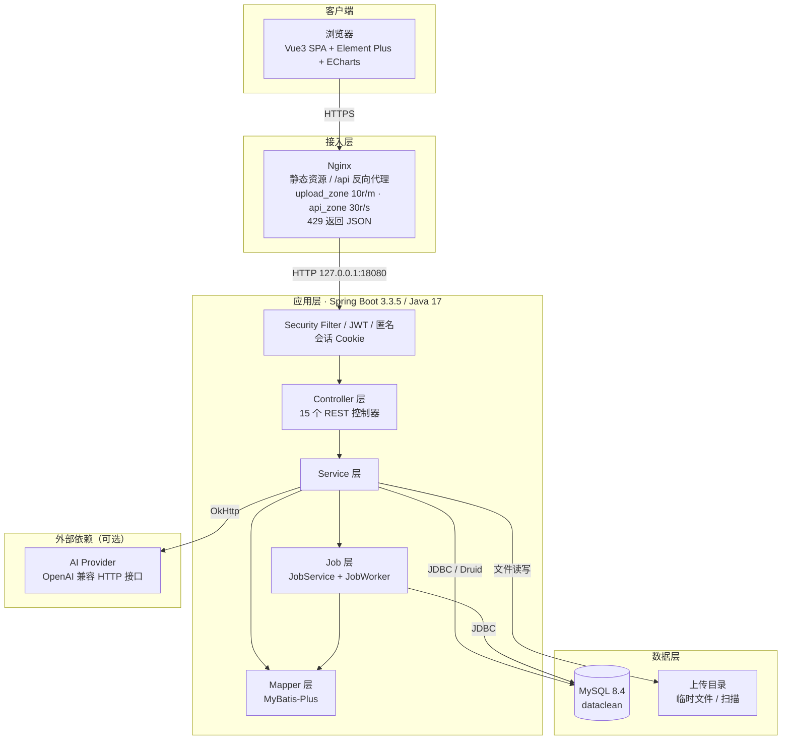
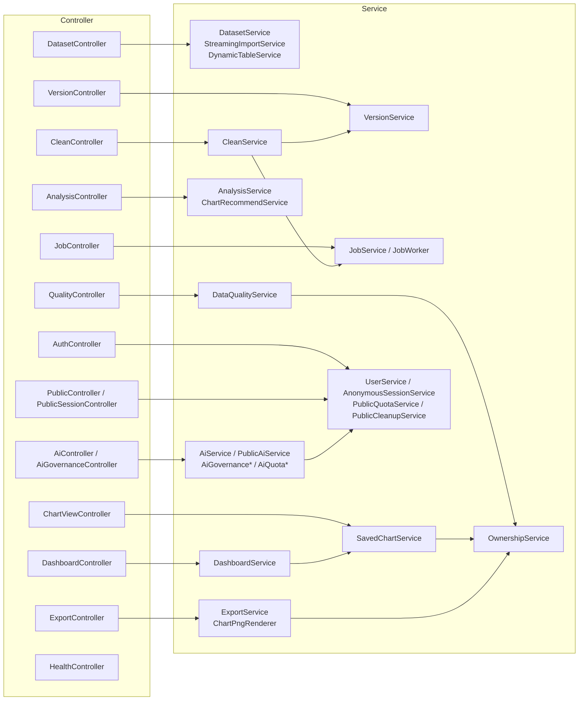
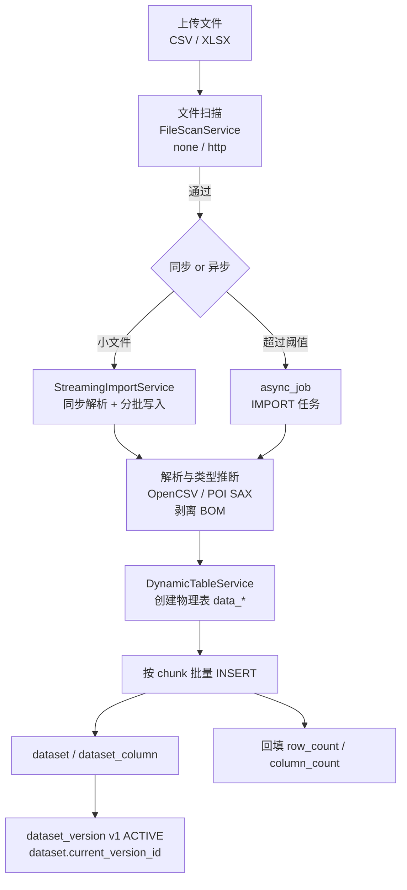
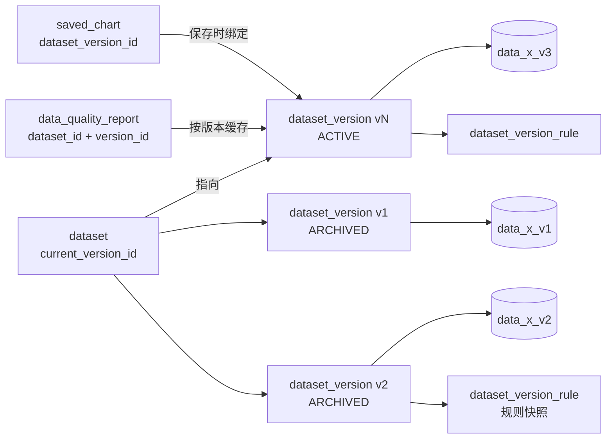
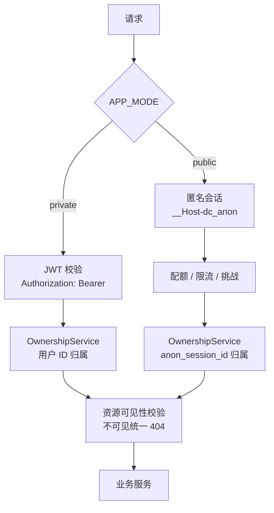
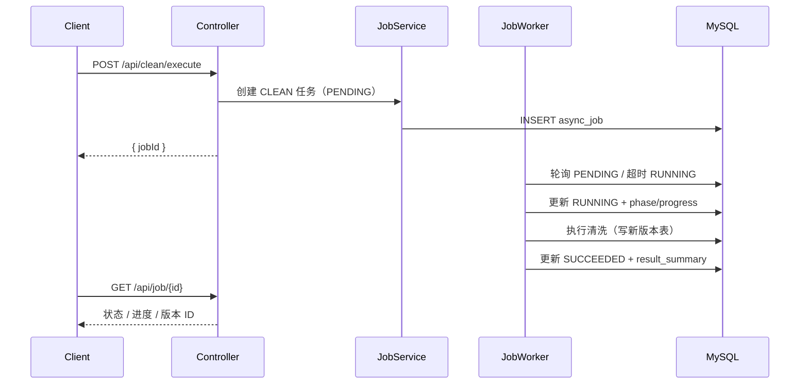
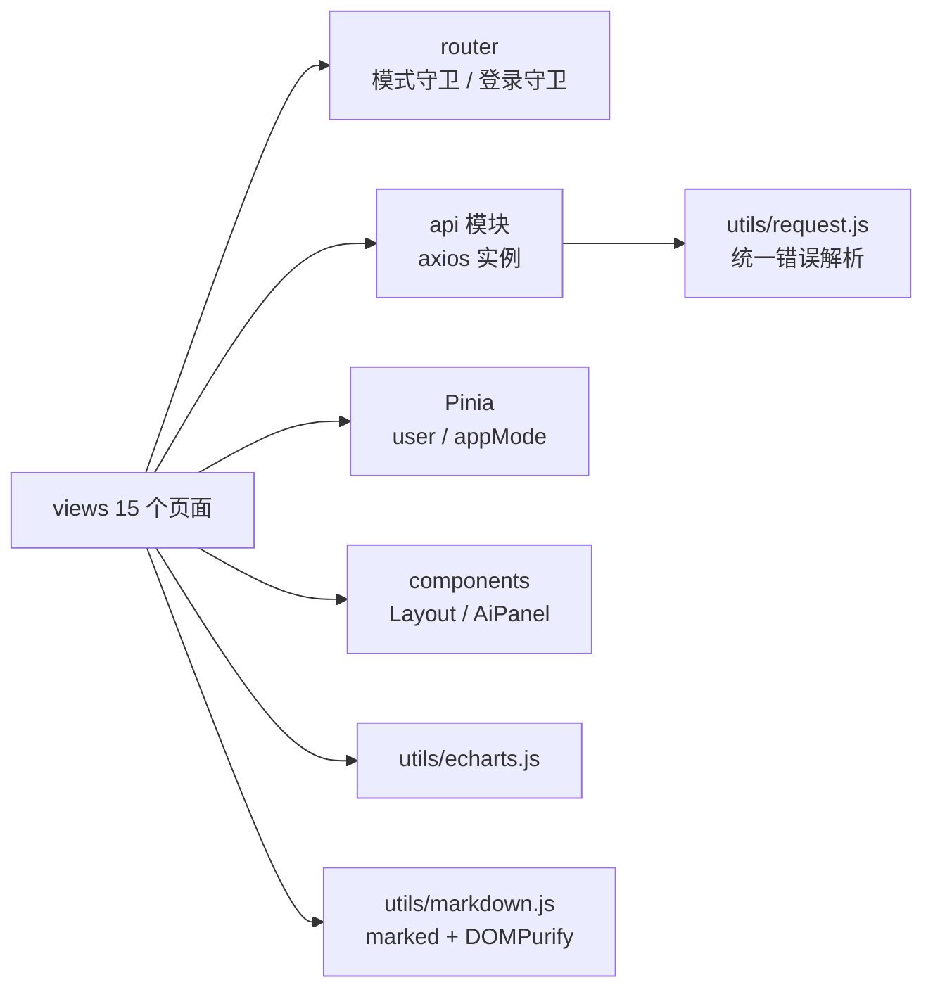

# 系统架构说明（2026-11-26）

> 依据仓库真实代码、`application.yml.example`、`docker-compose.yml` 与预发布 Nginx 配置整理，未包含未实现组件。
> 关联文档：[README](../README.md)、[数据库 ER](DATABASE_ER_2026-11-26.md)、[业务流程](BUSINESS_FLOWS_2026-11-26.md)、[技术总结](PROJECT_TECHNICAL_SUMMARY.md)。

---

## 1. 总体架构

### 部署端口边界

| 组件 | 端口 | 说明 |
|---|---|---|
| Nginx | 443 / 8443（HTTPS 覆盖配置）、80（默认 HTTP） | 唯一对外入口 |
| 后端 | 8080（预发布为 18080，仅绑定 127.0.0.1） | 不直接暴露 |
| 管理端口 | 8081（预发布 18081） | Actuator health/metrics/prometheus，仅内网 |
| MySQL | 3306 | 仅 `db_net` 内网，不映射宿主机 |

---

## 2. 后端分层与模块边界

### 分层职责

| 层 | 职责 | 关键约束 |
|---|---|---|
| Controller | 参数校验、返回 `Result<T>`、响应码映射 | 不写业务 SQL；破坏性操作校验确认头 |
| Service | 事务、规则执行、版本切换、权限、配额 | 版本只新增/切换，不原地覆盖 |
| Job | 持久化任务领取、执行、心跳、取消、重试 | 状态全部落库，重启可恢复 |
| Mapper | MyBatis-Plus CRUD 与少量 XML | 动态表名经过 `SqlGuard` 白名单校验 |

---

## 3. 数据处理架构

关键点：

- CSV 逐行读取，XLSX 使用 SAX 事件模型，不将整表载入内存。
- 前 200 行抽样推断 `INT / BIGINT / DECIMAL / DATETIME / VARCHAR / TEXT`；超长文本降级 `TEXT`。
- 动态表名由 `data_<清洗后名称>_<时间戳>` 生成，写入前经 `SqlGuard` 校验，避免 SQL 注入。
- 文件超过 `JOBS_ASYNC_IMPORT_ROWS`（默认 20000 行）或 `JOBS_ASYNC_IMPORT_BYTES`（5 MB）时转异步任务。

---

## 4. 版本与关联模型

- 每个版本对应独立物理表；切换版本只改 `current_version_id` 并刷新列元数据与统计缓存。
- 图表保存时记录 `dataset_version_id`；当前版本不同即 `stale=true`。
- 删除数据集时按 R2 策略级联清理元数据与图表；`clean_log`、`async_job`、`audit_log`、`export_record` 保留为历史。

---

## 5. 运行模式与安全边界

| 机制 | 实现 |
|---|---|
| 私有模式认证 | Spring Security + JWT（`jjwt`），`jwt.secret` 必须由环境变量提供 |
| 公开模式会话 | `anon_session` 表存 SHA-256 token，Cookie 为 `__Host-` 前缀 + Secure + HttpOnly + SameSite=Strict |
| 来源校验 | 固定 `PUBLIC_ALLOWED_ORIGIN` 白名单；IP 仅取可信代理头并 HMAC 摘要 |
| 资源隔离 | 不可见资源返回 404，不泄露存在性 |
| 限流 | Nginx `upload_zone`（上传 10 次/分钟，burst 3）、`api_zone`（30 次/秒）；429 返回 JSON |
| 配额 | 数据集数、存储量、行数、任务数、图表数、导出数、AI 调用与 token |
| 清理 | 过期匿名会话定时清理，逐项记录 `cleanup_item`，只报告不删除孤儿物理表 |

---

## 6. 异步任务架构

- 默认 2 个 worker 线程，2 秒轮询，单任务最长 1800 秒。
- 取消写 `cancel_requested_at`，Worker 在安全点检查并置 `CANCELLED`。
- 进程重启后，超时未心跳的 `RUNNING` 任务转为可恢复/失败，不会静默丢失。

---

## 7. 前端架构

- 路由在 `public` 模式下拦截 `/login`、`/system`、`/ai-config`、`/ai-governance`。
- `request.js` 统一处理 401/403/404/409/429，409 版本冲突交由页面提示重新确认。
- 导出、清洗、上传、看板布局等操作均有组件级 loading/guard，防止重复提交。

---

## 8. 可观测性

| 内容 | 位置 |
|---|---|
| 健康检查 | `GET /api/health`（业务）与 `/actuator/health`（管理端口） |
| 指标 | `/actuator/prometheus`，Prometheus 抓取配置见 `deploy/monitoring/` |
| 审计 | `audit_log`（操作类型、资源、结果、脱敏摘要） |
| AI 调用 | `ai_call_log`（场景、模型、耗时、token、成本、结果，不含 Prompt/响应） |
| 清理 | `cleanup_log` + `cleanup_item` |
| 日志 | `logback-spring.xml`，按级别输出，不打印敏感值 |
