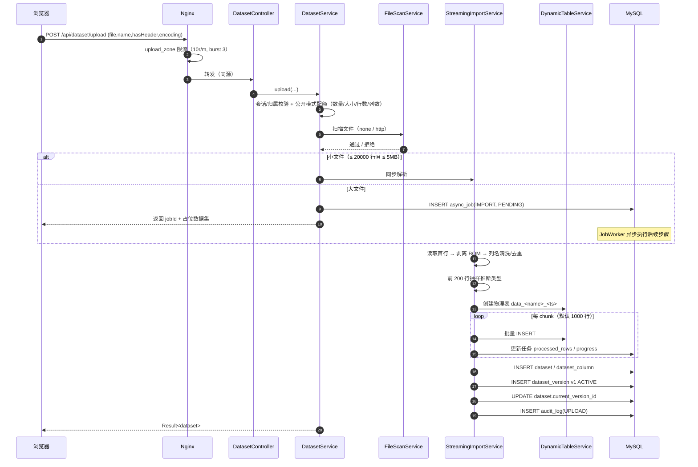
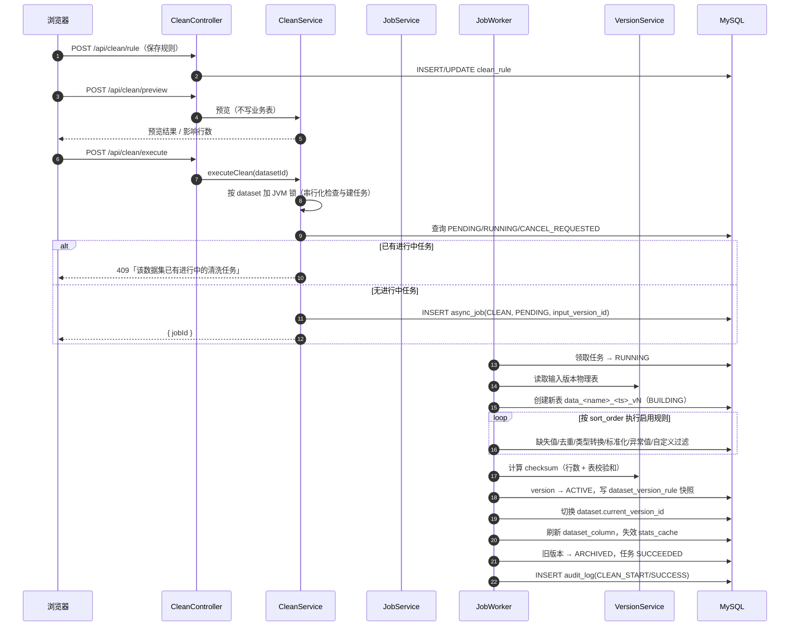
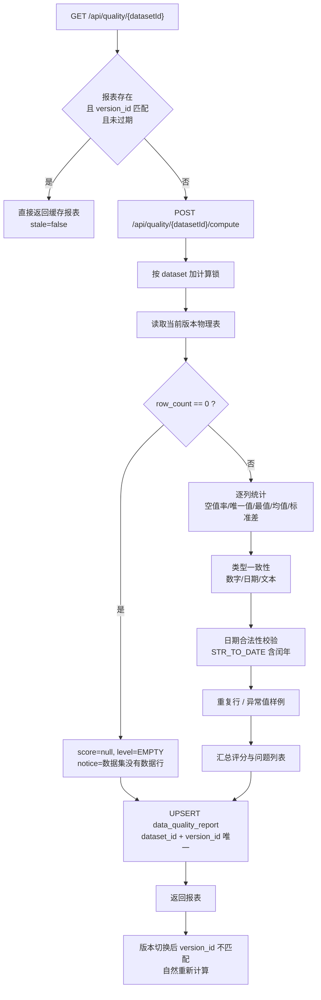
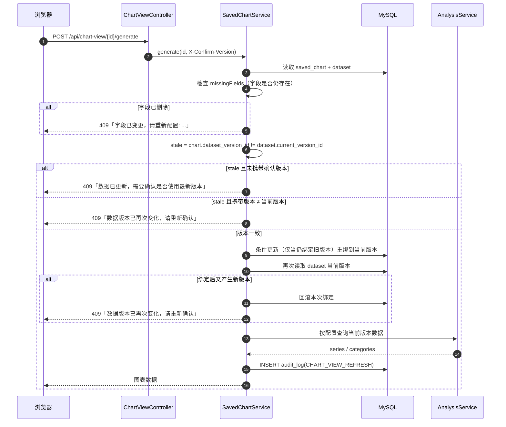
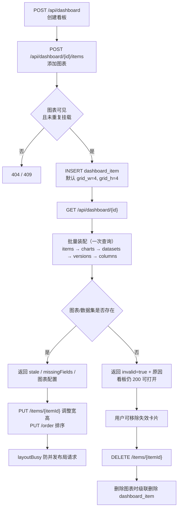
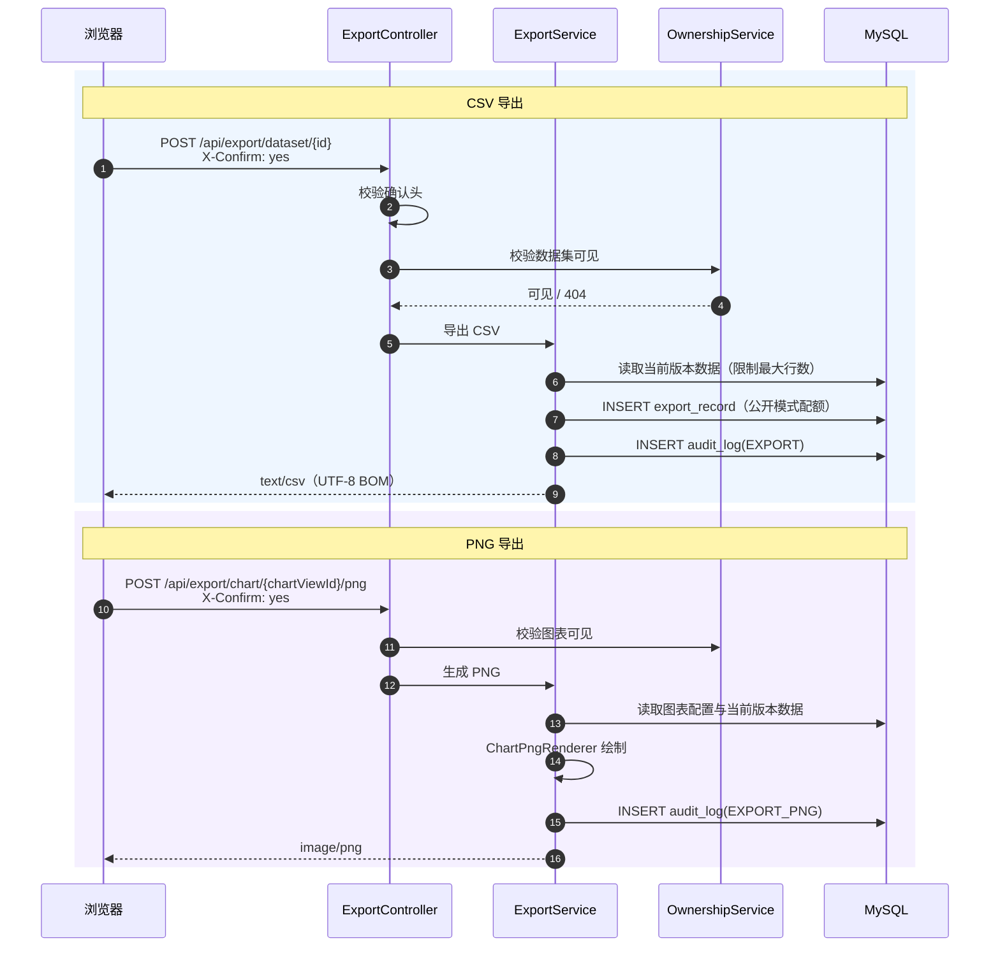

# 核心业务流程图（2026-11-26）

> 覆盖 6 条主链路：上传解析、清洗与版本、质量计算、图表版本刷新、看板管理、导出。
> 图中接口、状态值与异常码均与当前代码一致；每一步的「失败分支」单列说明。

---

## 1. 上传解析流程

**失败分支**

| 场景 | 结果 |
|---|---|
| 文件为空 / 无法解析 / 损坏 XLSX | 400「Excel 解析失败，请检查文件格式」，不创建数据集 |
| `.xls` 旧格式 | 400，提示另存为 `.xlsx` 或 CSV |
| 超出行/列/大小限制 | 400，配额提示 |
| 扫描不通过 | 400/403，临时文件清理 |
| 上传过于频繁 | Nginx 429 JSON `{"code":429,"message":"请求过于频繁，请稍后重试"}` |
| 异步任务失败 | `async_job.status=FAILED`，`error_summary` 脱敏摘要，占位数据集标记失败 |

---

## 2. 清洗与版本流程

**关键约束**

- 清洗只新增版本，不原地修改输入版本。
- 规则快照写入 `dataset_version_rule`；后续规则被删除也不影响历史版本解释。
- 失败时：新版本 `FAILED`，`current_version_id` 不变，任务记录 `error_code/error_summary`。
- 取消：写 `cancel_requested_at`，Worker 在安全点停止并置 `CANCELLED`。

---

## 3. 质量计算流程

**修复后的准确性规则（R3）**

| 场景 | 行为 |
|---|---|
| 文本列做 SUM/AVG | 400，提示仅支持 COUNT |
| `2026-02-30`、`2025-02-29` | 判为非法日期，计入 DATE 异常样例 |
| 0 行数据集 | 不返回 100 分，`score` 缺省、`level=EMPTY` |
| CSV 首列 BOM | 列名剥离 BOM，不产生 `_金额_元_` 之类脏名 |

---

## 4. 图表版本刷新流程

**状态语义**

| 字段 | 含义 |
|---|---|
| `stale=true` | 图表绑定版本落后于数据集当前版本 |
| `missingFields` | 配置引用的字段在当前版本已不存在 |
| `invalid=true`（看板项） | 图表或数据集已被删除，卡片失效 |

---

## 5. 看板管理流程

**容错原则（R2）**

- 单项失效不导致看板整体 404；显式返回 `invalid` 与原因。
- 真实错误（数据库异常、权限异常）不被「失效」掩盖，仍按 500/403 返回。
- 看板详情使用批量装配，消除逐项查询的 N+1（实测 SQL 35 → 14）。

---

## 6. 导出流程

**失败分支**

| 场景 | 结果 |
|---|---|
| 缺少 `X-Confirm: yes` | 400，明确提示需要确认 |
| 资源不可见 | 404（不泄露存在性） |
| 公开模式超出导出配额 | 429/403，配额提示 |
| 导出期间数据版本变化 | 图表导出走版本校验，冲突返回 409；CSV 读取当前版本快照 |
| 后端返回 JSON 错误 | 前端按 `Content-Type` 判定，不把 JSON 存成 CSV/PNG（R1 修复） |
| 并发点击导出 | 前端按钮 loading + 后端确认头/配额双重约束，不产生重复文件 |
