# 数据库 ER 图与关系说明（2026-11-26）

> 依据 `information_schema` 实际结构（库 `dataclean`，MySQL 8.4）与 `db/migration/V1`–`V11` 整理。
> **重要**：库中**没有数据库外键约束**，下图为逻辑关系；完整性由应用层事务与删除策略保证。

---

## 1. 核心 ER 图

```mermaid
erDiagram
    DATASET ||--o{ DATASET_COLUMN : "字段元数据"
    DATASET ||--o{ DATASET_VERSION : "版本"
    DATASET_VERSION ||--o{ DATASET_VERSION_RULE : "规则快照"
    DATASET ||--o{ CLEAN_RULE : "清洗规则"
    DATASET ||--o{ CLEAN_LOG : "清洗日志"
    DATASET ||--o{ DATA_QUALITY_REPORT : "质量报表"
    DATASET ||--o{ STATS_CACHE : "统计缓存"
    DATASET ||--o{ SAVED_CHART : "图表视图"
    DATASET ||--o{ ASYNC_JOB : "异步任务"
    DATASET ||--o{ CHART_VIEW : "匿名图表记录"
    DATASET ||--o{ EXPORT_RECORD : "导出记录"
    DATASET ||--o{ BACKUP_TABLE : "备份表登记"
    SAVED_CHART ||--o{ DASHBOARD_ITEM : "看板卡片"
    DASHBOARD ||--o{ DASHBOARD_ITEM : "包含"
    ANON_SESSION ||--o{ DATASET : "公开模式归属"
    ANON_SESSION ||--o{ SAVED_CHART : "公开模式归属"
    ANON_SESSION ||--o{ DASHBOARD : "公开模式归属"
    ANON_SESSION ||--o{ ASYNC_JOB : "公开模式归属"
    ANON_SESSION ||--o{ CLEANUP_ITEM : "清理明细"
    DATASET_VERSION ||--o{ BACKUP_TABLE : "备份来源"

    DATASET {
        bigint id PK
        varchar name
        varchar table_name UK
        bigint current_version_id "指向当前版本"
        int row_count
        int column_count
        tinyint status
        varchar owner_type "private/demo/anon"
        bigint anon_session_id
        bigint created_by
        bigint updated_by
    }

    DATASET_COLUMN {
        bigint id PK
        bigint dataset_id
        varchar column_name
        varchar column_alias
        varchar data_type
        int sort_order
        int unique_count
        int null_count
        varchar min_value
        varchar max_value
        decimal mean_value
        decimal std_value
    }

    DATASET_VERSION {
        bigint id PK
        bigint dataset_id
        int version_no "dataset_id+version_no 唯一"
        varchar table_name
        bigint row_count
        int column_count
        varchar checksum
        varchar status "BUILDING/ACTIVE/ARCHIVED/FAILED"
        varchar source "IMPORT/CLEAN/RESTORE/BACKFILL"
        bigint job_id
        varchar owner_type
        bigint anon_session_id
    }

    DATASET_VERSION_RULE {
        bigint id PK
        bigint version_id
        bigint rule_id "原规则可能已删除"
        varchar rule_type
        longtext rule_config
        int sort_order
        varchar snapshot_hash
    }

    CLEAN_RULE {
        bigint id PK
        bigint dataset_id
        varchar rule_name
        varchar rule_type
        json rule_config
        int sort_order
        tinyint status
        bigint anon_session_id
    }

    CLEAN_LOG {
        bigint id PK
        bigint dataset_id
        varchar rule_ids
        json rule_snapshot
        int before_count
        int after_count
        int affected_rows
        varchar backup_table
        tinyint status
        int execute_time_ms
        bigint anon_session_id
    }

    DATA_QUALITY_REPORT {
        bigint id PK
        bigint dataset_id
        bigint version_id "dataset+version 唯一"
        varchar status "COMPUTING/DONE/FAILED"
        json payload
        datetime computed_at
        datetime expires_at
        varchar owner_type
        bigint anon_session_id
    }

    STATS_CACHE {
        bigint id PK
        bigint dataset_id UK
        bigint version_id "版本切换失效"
        longtext payload
        datetime expires_at
    }

    SAVED_CHART {
        bigint id PK
        bigint dataset_id
        bigint dataset_version_id "保存时绑定"
        varchar owner_type
        bigint anon_session_id
        bigint user_id
        varchar title
        varchar chart_type
        json chart_config
        char config_hash
    }

    DASHBOARD {
        bigint id PK
        varchar owner_type
        bigint anon_session_id
        bigint user_id
        varchar title
    }

    DASHBOARD_ITEM {
        bigint id PK
        bigint dashboard_id
        bigint saved_chart_id "dashboard+chart 唯一"
        int sort_order
        int grid_x
        int grid_y
        int grid_w
        int grid_h
    }

    ASYNC_JOB {
        bigint id PK
        varchar job_type "IMPORT/CLEAN/RESTORE"
        bigint dataset_id
        bigint input_version_id
        bigint output_version_id
        varchar status
        varchar phase
        int progress
        bigint processed_rows
        bigint total_rows
        int retry_count
        int max_retries
        varchar error_code
        varchar error_summary
        varchar owner_type
        bigint anon_session_id
        bigint user_id
    }

    BACKUP_TABLE {
        bigint id PK
        bigint dataset_id
        bigint version_id
        varchar table_name UK
        varchar checksum
        bigint row_count
        varchar state "READY/EXPIRED/DROPPED"
    }

    ANON_SESSION {
        bigint id PK
        char token_hash UK
        datetime expires_at
        char ip_hash
        tinyint revoked
        varchar cleanup_state
        int cleanup_attempts
    }

    CLEANUP_ITEM {
        bigint id PK
        bigint anon_session_id
        varchar resource_type
        varchar resource_key
        varchar state
    }

    CHART_VIEW {
        bigint id PK
        bigint anon_session_id
        bigint dataset_id
        varchar chart_type
        json chart_config
    }

    EXPORT_RECORD {
        bigint id PK
        bigint anon_session_id
        bigint dataset_id
        varchar export_type
        int row_count
    }
```

---

## 2. 关系与约束说明

### 2.1 版本链

| 关系 | 基数 | 说明 |
|---|---|---|
| `dataset.current_version_id` → `dataset_version.id` | 1 : 0..1 | 当前可用版本指针；为空时由应用补建 v1 |
| `dataset_version.dataset_id` → `dataset.id` | N : 1 | 一个数据集多个版本 |
| `dataset_version_rule.version_id` → `dataset_version.id` | N : 1 | 清洗规则快照；`rule_id` 仅记录来源，规则删除后快照仍保留 |

- 唯一键：`uk_dv_dataset_version (dataset_id, version_no)`。
- 版本状态：`BUILDING` → `ACTIVE` → `ARCHIVED`；失败为 `FAILED`。
- 版本物理表命名：`data_<name>_<timestamp>_v<N>`，与 `dataset_version.table_name` 一一对应。

### 2.2 图表与看板

| 关系 | 基数 | 说明 |
|---|---|---|
| `saved_chart.dataset_id` → `dataset.id` | N : 1 | 图表所属数据集 |
| `saved_chart.dataset_version_id` → `dataset_version.id` | N : 1 | 保存时绑定的版本，用于 `stale` 判定 |
| `dashboard_item.saved_chart_id` → `saved_chart.id` | N : 1 | 看板卡片引用图表 |
| `dashboard_item.dashboard_id` → `dashboard.id` | N : 1 | 看板包含多个卡片 |

- 唯一键：`uk_di_dashboard_chart (dashboard_id, saved_chart_id)`，同一图表同一看板只挂一次。
- 删除图表时主动删除 `dashboard_item`；若仍存在历史孤儿，看板详情降级为失效卡片。

### 2.3 质量与统计缓存

- `data_quality_report` 唯一键 `uk_dqr_dataset_version (dataset_id, version_id)`：每个版本一份报表。
- 版本切换后旧报表不删除，但查询按当前 `version_id` 取用，自然视为过期。
- `stats_cache` 唯一键 `uk_stats_dataset (dataset_id)`，`version_id` 不匹配即失效。

### 2.4 任务与备份

- `async_job.dataset_id`/`input_version_id`/`output_version_id` 均为逻辑引用。
- `backup_table.table_name` 唯一，登记清洗/恢复产生的备份物理表；`state` 为 `READY/EXPIRED/DROPPED`。
- 删除数据集前拦截 `PENDING/RUNNING/CANCEL_REQUESTED` 任务（409）。

### 2.5 公开模式归属

所有业务主表通过 `owner_type`（`private/demo/anon`）+ `anon_session_id` 表达归属：

| 表 | 归属字段 |
|---|---|
| `dataset` | `owner_type`、`anon_session_id` |
| `saved_chart` | `owner_type`、`anon_session_id`、`user_id` |
| `dashboard` | `owner_type`、`anon_session_id`、`user_id` |
| `async_job` | `owner_type`、`anon_session_id`、`user_id` |
| `dataset_version` | `owner_type`、`anon_session_id` |
| `data_quality_report` | `owner_type`、`anon_session_id` |

访问控制统一走 `OwnershipService`：不可见资源返回 404，不区分「不存在」与「无权限」。

---

## 3. 表清单（35 张）

| 分组 | 表 |
|---|---|
| 数据集与版本 | `dataset`、`dataset_column`、`dataset_version`、`dataset_version_rule` |
| 清洗 | `clean_rule`、`clean_log`、`backup_table` |
| 质量与统计 | `data_quality_report`、`stats_cache` |
| 分析与看板 | `saved_chart`、`dashboard`、`dashboard_item`、`chart_view` |
| 任务与审计 | `async_job`、`async_task`（预留）、`audit_log`、`export_record` |
| 公开模式 | `anon_session`、`anon_usage_daily`、`ai_challenge`、`cleanup_item`、`cleanup_log` |
| AI | `ai_config`、`ai_prompt_template`、`ai_generation_log`、`ai_provider`、`ai_model`、`ai_scene_route`、`ai_call_log`、`ai_quota`、`ai_usage`、`ai_circuit_state` |
| 系统 | `user`、`sys_config`、`schema_migration` |

> `async_task` 为 V5 预留表，当前业务使用 `async_job`；`async_task` 保留但无写入。
> 动态数据表 `data_*`、`*_vN`、`*_backup_*` 不在此清单中，由元数据登记与归属。

---

## 4. 删除策略（R2 起）

| 删除对象 | 清理 | 保留 |
|---|---|---|
| 数据集 | `dataset_column`、`dataset_version`、`dataset_version_rule`、`data_quality_report`、`clean_rule`、`stats_cache`、`backup_table`、`saved_chart`、`dashboard_item`、`chart_view`、动态物理表 | `clean_log`（审计历史）、`async_job`、`audit_log`、`export_record`、`ai_call_log` |
| 图表 | `dashboard_item` | — |
| 版本 | 物理表按策略归档/删除 | `clean_log` 审计 |

历史孤儿数据（R2 基线段：孤儿质量报表 7 条、规则快照 4 条、物理表 5 张）**未自动清理**，处理方案与审计 SQL 见 [BACKLOG](BACKLOG.md)。
